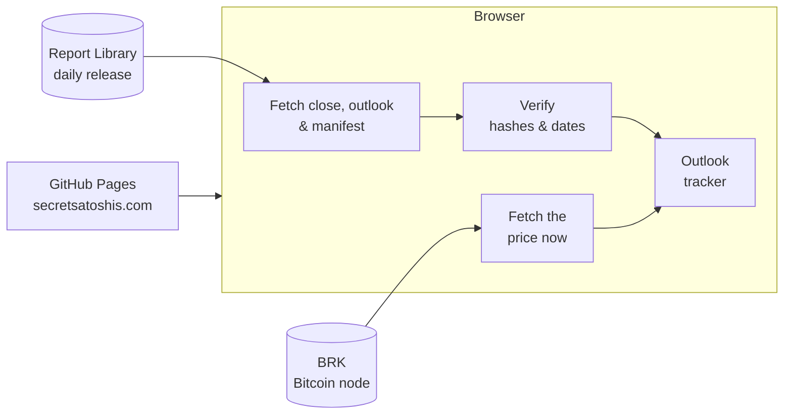

# Secret Satoshis

The home page of the [Secret Satoshis](https://secretsatoshis.com/) newsletter: a yearly Bitcoin
price outlook and weekly market analysis that tracks it, written for long-term investors. The
site shows where the price sits today against the year's outlook, and points visitors to the
newsletter, Agent 21, the Market Dashboard and the Chart Library.

- **Visit the site:** [secretsatoshis.com](https://secretsatoshis.com/)
- **Read the newsletter:** [newsletter.secretsatoshis.com](https://newsletter.secretsatoshis.com/)

## What's on the site

| Section | What it does |
|---------|--------------|
| **Hero** | "The Secret Satoshis Newsletter", a button down to the outlook tracker, and Agent 21, which follows the cursor, says it's ready when pointed at, and links to its site |
| **Newsletter** | The yearly, weekly, quarterly and year-end issues, the live outlook tracker, and a sign-up form that goes straight to Substack |
| **Your Next Step** | Start Here, the Chart Library, the Market Dashboard and the open-source code on GitHub |

Alongside the home page are a privacy page, a 404 page, a sitemap, `robots.txt`, and
[`llms.txt`](llms.txt), a short guide to the platform for AI agents.

## How it works



The site is plain HTML, CSS and JavaScript with no build step and no dependencies. GitHub
Pages serves the `main` branch at the custom domain in `CNAME`, so every push to `main` goes
live. Fonts are self-hosted, and the pages load nothing from other services except the outlook
tracker's live data: the Report Library's release, and the price now from
[BRK](https://bitview.space/). The home page's Content-Security-Policy allows those two sources
only.

The `agent21/` folder holds the Agent 21 app, which deploys separately to
[agent21.secretsatoshis.com](https://agent21.secretsatoshis.com/). Agent 21's face and the
hero layout are shared with it: `js/agent21-face.js` and `css/agent21-face.css`.

## The outlook tracker

The newsletter section shows where Bitcoin's price sits today against the year's published
bear, base and bull cases. Nothing in it is hardcoded: `js/main.js` reads three files from the
[Report Library's release](https://secretsatoshis.github.io/Bitcoin-Report-Library/csv/release_manifest.json),
and the price now from BRK:

| Source | What the tracker uses |
|--------|-----------------------|
| `report_ohlc_summary.csv` | The latest daily close and its date |
| `price_outlook.csv` | The case levels (rows typed `case`) and the year they forecast |
| `release_manifest.json` | The release's report date and the SHA-256 hash of each file |
| BRK `/api/v1/prices` | The price now, shown as of the visitor's date |

The tracker stays hidden if any file can't be fetched, the case levels are malformed, the
files' hashes or report date don't match the manifest, or the outlook is for a different year
than the latest close. A hidden tracker logs the reason to the browser console. BRK's price
is used only when it is from the last six hours, within 1.5 times the latest close and in the
outlook's year; otherwise the tracker shows the latest close as of its date, and says why in
the console. If the data ever moves, update `connect-src` in `index.html`'s
Content-Security-Policy to match.

## Quick start

Serve the folder over HTTP, so root-relative links and browser security behave as they do in
production:

```bash
python3 -m http.server 8000
```

Then open [http://localhost:8000](http://localhost:8000). The outlook tracker reads live data,
so it needs a network connection.

Run the tests with Node 20 or later (older versions run only some of them):

```bash
node --test tests/*.test.cjs
```

They cover the tracker's parsing and data checks, and check that every page's local files
exist, share one cache version per asset, and load no fonts or styles from another service.
GitHub Actions runs them on every pull request and every push to `main`.

## Making changes

- **Analytics:** the public homepage, Dashboard, and Chart Library use
  `js/analytics.js?v=1` with GA4 stream `G-9GQYJPLLC8`. Local previews and
  file exports skip tracking. Agent 21 mounts a cross-origin analytics frame
  only on its public landing and waitlist pages; Google scripts do not run in
  the chat app. Update the shared script version on all products when changing it.
- **CSS or JavaScript:** pages load their stylesheets and scripts with a version query, such
  as `style.css?v=26`. Raise the version of the file you changed on every page that loads it,
  so every visitor gets the new file. The tests fail if the pages disagree. `js/agent21-face.js`
  is imported by `js/agent21-hero.js` with its own `?v=`: raise it there, and the hero script's
  version in `index.html`.
- **Page content:** update the page's `<lastmod>` in `sitemap.xml`.
- **Products, chart counts or links:** keep `llms.txt` in step with the site. Agent 21's own
  `llms.txt` is generated by `agent21/scripts/prepare-static.mjs` from `agent21/site.json`;
  the Market Dashboard and Chart Library generate theirs in their own builds.

## Project layout

| Path | What's there |
|------|--------------|
| `index.html` | The home page |
| `privacy.html`, `404.html` | The privacy and not-found pages |
| `css/style.css` | Page styles |
| `css/agent21-face.css` | Agent 21's face and the hero, shared with the Agent 21 app |
| `css/fonts.css` | Self-hosted font rules, one per character set |
| `js/main.js` | Navigation, scroll effects and the outlook tracker |
| `js/agent21-face.js` | Draws and animates Agent 21, shared with the Agent 21 app |
| `js/agent21-hero.js` | The hero's Agent 21 |
| `assets/fonts/` | Syne and JetBrains Mono, with their licenses |
| `assets/images/` | The logo, favicon and social cards |
| `llms.txt`, `robots.txt`, `sitemap.xml` | Guides for AI agents, crawlers and search engines |
| `tests/` | Outlook tracker and page checks |
| `agent21/` | The Agent 21 app, deployed separately |

## License

[GPL-3.0](LICENSE). The fonts are under the SIL Open Font License; see `assets/fonts/`.
